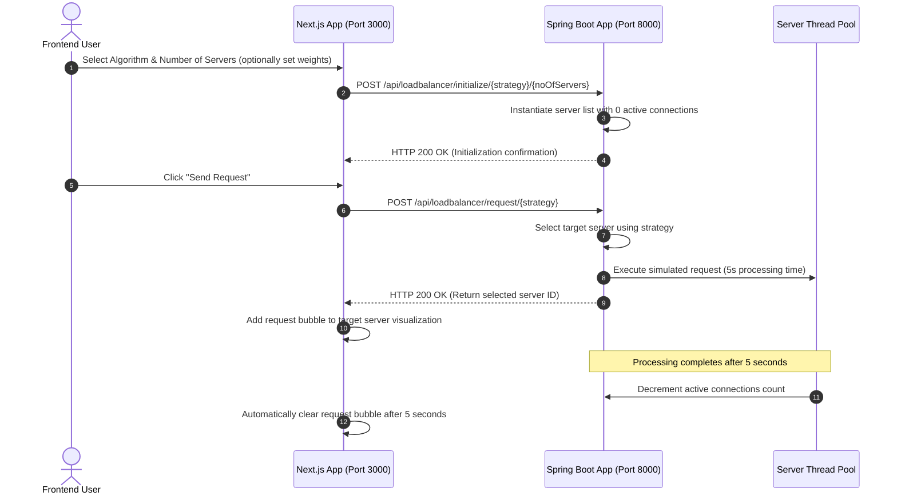
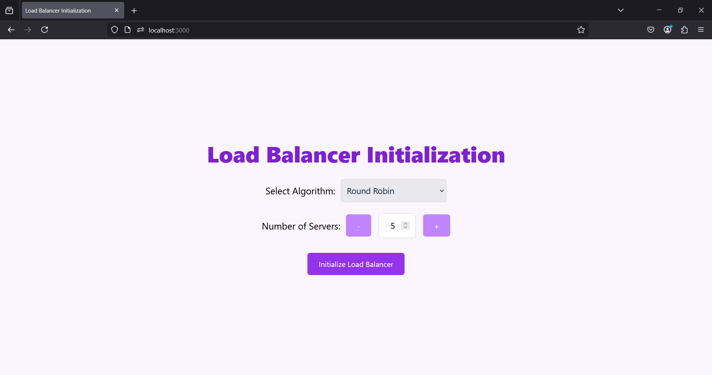
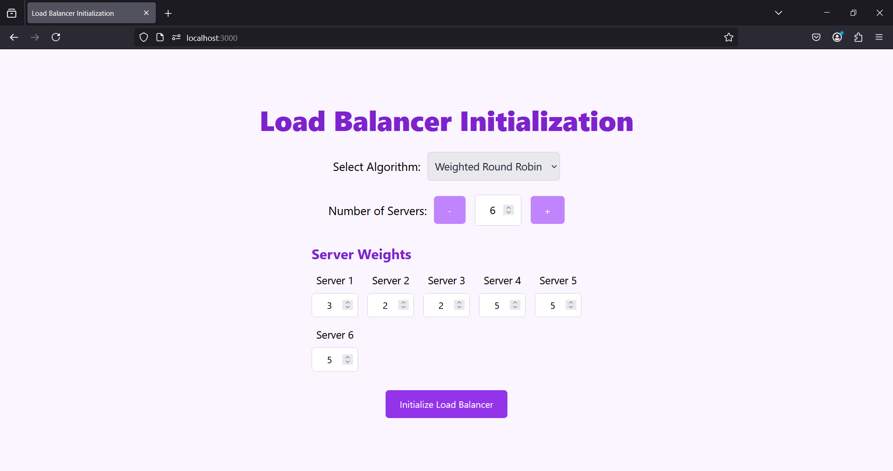
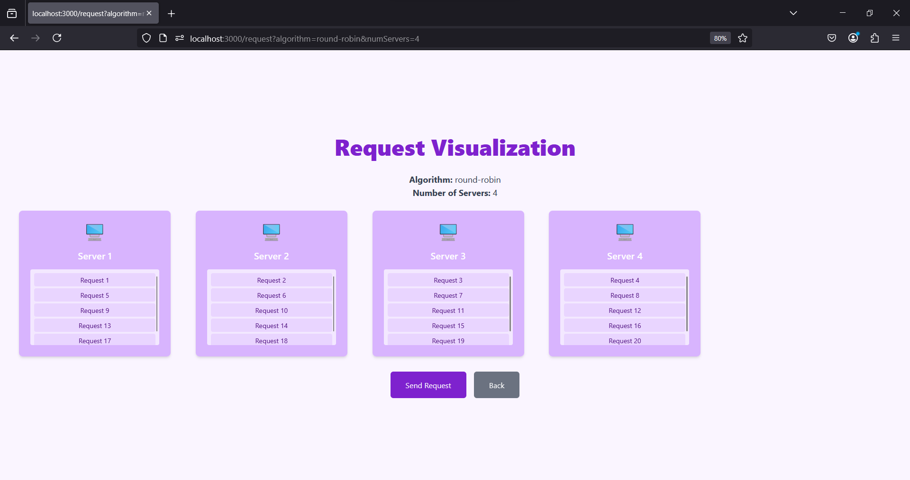
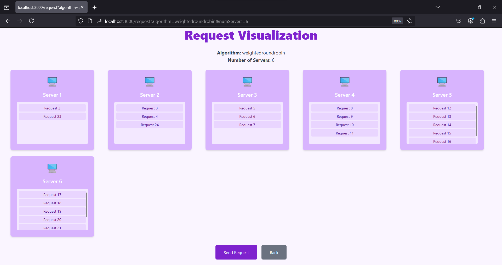
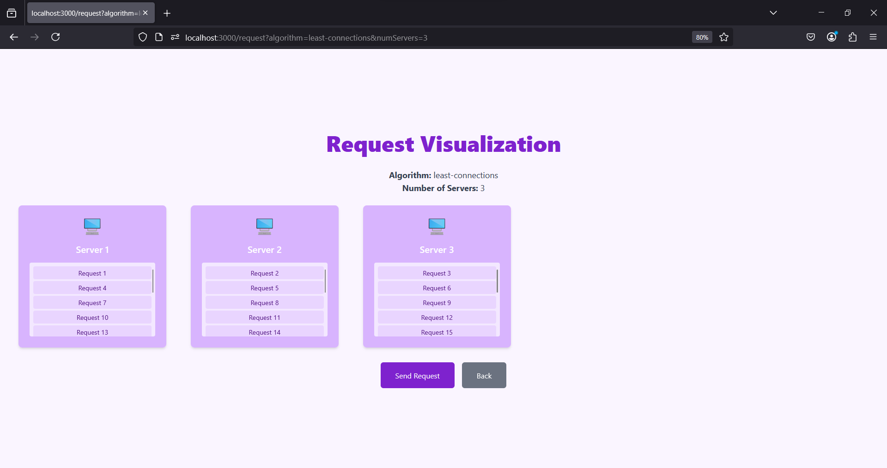

# 🌐 Load Balancer Visualization Platform

A full-stack, interactive simulation and visualization platform designed to demonstrate the inner workings of core load balancing algorithms in real-time. This project features a robust **Spring Boot (Java)** backend handling the routing simulation and concurrency control, paired with a modern, responsive **Next.js (React)** frontend using **Tailwind CSS** to visualize traffic distribution.

---

## 🚀 Key Features

* **Interactive Simulation:** Dynamically configure the number of servers, request load, and individual server weights.
* **Three Classic Algorithms:**
  * **Round Robin (RR):** Distributes client requests sequentially across the server pool.
  * **Weighted Round Robin (WRR):** Routes traffic proportionally using custom server weights and active connection limits.
  * **Least Connections (LC):** Identifies and assigns incoming requests to the server with the minimum active connection load in real-time.
* **Real-time Visual Feedback:** Clean, animated UI cards representing servers, showing their currently active connections/requests.
* **Simulated Request Latency:** Simulates realistic network request lifecycles (5-second execution duration per request) on the backend using multi-threaded execution.

---

## 🛠️ Tech Stack

### Backend
* **Java 17** - Core programming language.
* **Spring Boot 3.4.1** - Web framework for controller endpoints and dependency injection.
* **Maven** - Build automation and dependency management tool.

### Frontend
* **Next.js (React)** - Modern frontend framework.
* **Tailwind CSS** - Clean, utility-first CSS styling.
* **Fetch API** - Dynamic communication with backend endpoints.

---

## 📐 Architecture & Flow

The system operates as a classic Client-Server system design simulation:



---

## 🧬 Algorithm Implementation Details

### 1. Round Robin
* **Description:** Distributes requests evenly across all servers.
* **Implementation:** Tracks a rolling index (`currIndex`). Each incoming request receives `currIndex`, and then the index is incremented and wrapped around using a modulo operation:
  ```java
  currIndex = (currIndex + 1) % serverList.size();
  ```

### 2. Weighted Round Robin
* **Description:** Routes requests based on predefined weights assigned to each server.
* **Implementation:** Traverses servers in sequence. It will route requests to a server if `server.getWeight() > server.getActiveConnections()`. Otherwise, it attempts the next server. This dynamically prioritizes higher-weighted servers while preventing overload beyond their designated capacity.

### 3. Least Connections
* **Description:** Assigns requests to the server with the lowest current workload.
* **Implementation:** Dynamically filters the list of servers using stream APIs to find the server instance with the minimum number of active connections:
  ```java
  Server leastLoadedServer = serverList.stream()
          .min((s1, s2) -> Integer.compare(s1.getActiveConnections(), s2.getActiveConnections()))
          .orElse(null);
  ```

### Concurrency & Simulation
* **Thread Safety:** Each server class uses `AtomicInteger` to manage and read `activeConnections` across threads.
* **Workload Simulation:** A fixed-thread-pool executor (`Executors.newFixedThreadPool(1)`) on each server manages request processing by putting the thread to sleep for **5 seconds** before decrementing the connection count:
  ```java
  public int assignRequest() {
      activeConnections.incrementAndGet();
      executorService.submit(() -> {
          try {
              Thread.sleep(5000); // 5 seconds sleep simulation
          } catch (InterruptedException e) {
              Thread.currentThread().interrupt();
          } finally {
              activeConnections.decrementAndGet();
          }
      });
      return id;
  }
  ```

---

## 📡 API Endpoints

All backend endpoints are prefixed with `/api/loadbalancer`.

### 1. Initialize Load Balancer
* **Method:** `POST`
* **URL:** `/initialize/{strategy}/{noOfServers}`
* **Path Variables:**
  * `strategy`: `roundrobin` | `weightedroundrobin` | `leastconnections`
  * `noOfServers`: Number of servers to initialize (Integer)
* **Request Body (JSON) - *Optional, only needed for Weighted Round Robin*:**
  ```json
  {
    "weights": [3, 1, 5, 2, 4]
  }
  ```
* **Response:** `200 OK`
  ```text
  Initialized weightedroundrobin load balancer with 5 servers.
  ```

### 2. Dispatch Request
* **Method:** `POST`
* **URL:** `/request/{strategy}`
* **Path Variables:**
  * `strategy`: `roundrobin` | `weightedroundrobin` | `leastconnections`
* **Response:** `200 OK` (returns the Integer ID of the server selected to process the request, or `-1` if all servers are at full capacity)
  ```json
  3
  ```

---

## 📁 Directory Structure

```text
LoadBalancerVisulization-main/
├── .mvn/                         # Maven Wrapper files
├── Load_balance_images/          # Demo screenshots
│   ├── home.png
│   ├── init.png
│   ├── RR.png
│   ├── WRR.png
│   └── leastConnection.png
├── frontend/                     # Next.js Application
│   ├── pages/
│   │   ├── _app.js               # App wrapper and global CSS setup
│   │   ├── index.js              # Home/Initialization dashboard
│   │   └── request.js            # Request visualization UI
│   ├── styles/
│   │   ├── global.css
│   │   └── Home.module.css
│   ├── package.json
│   ├── postcss.config.js
│   └── tailwind.config.js
├── src/                          # Spring Boot Backend
│   ├── main/
│   │   ├── java/com/example/LoadBalancerSpringBoot/
│   │   │   ├── controller/       # Web controllers
│   │   │   ├── service/          # Load balancer logic implementations
│   │   │   └── util/             # Utility models (Server.java)
│   │   └── resources/
│   │       └── application.properties # Server port setting (8000)
├── mvnw                          # Maven wrapper executable (Unix)
├── mvnw.cmd                      # Maven wrapper executable (Windows)
└── pom.xml                       # Maven build descriptor
```

---

## 🚀 Getting Started

Follow these steps to run the application locally.

### Prerequisites
* **Java Development Kit (JDK) 17** or higher
* **Node.js** (v18 or higher) & **npm**

### Step 1: Run the Backend (Spring Boot)
1. Navigate to the project root directory:
   ```bash
   cd LoadBalancerVisulization-main
   ```
2. Run the application using the Maven wrapper:
   * **Windows (PowerShell/CMD):**
     ```bash
     ./mvnw.cmd spring-boot:run
     ```
   * **Linux/macOS:**
     ```bash
     chmod +x mvnw
     ./mvnw spring-boot:run
     ```
   * Alternatively, open the folder in Eclipse IDE, IntelliJ IDEA, or VS Code and run `LoadBalancerSpringBootApplication.java` directly.
3. The backend will start and listen on port **`8000`**.

### Step 2: Run the Frontend (Next.js)
1. Open a new terminal and navigate to the frontend directory:
   ```bash
   cd LoadBalancerVisulization-main/frontend
   ```
2. Install the required dependencies:
   ```bash
   npm install
   ```
3. Start the development server:
   ```bash
   npm run dev
   ```
4. Open your browser and navigate to **`http://localhost:3000`**.

---

## 📷 Screenshots in Action

### 🏠 Home Page
Select the load balancing algorithm you want to test and visualize.


### ⚙️ Configuration Screen
Configure weights for each server (Weighted Round Robin) and select server count.


### 🔄 Round Robin Visualization
Watch requests get assigned sequentially.


### ⚖️ Weighted Round Robin Visualization
Requests are routed proportionally based on the custom server weights.


### 📉 Least Connections Visualization
Requests automatically flow to the server containing the lowest connection count in real-time.


---

## 🤝 Contributing
Contributions make the open-source community amazing!
1. Fork the Project.
2. Create your Feature Branch (`git checkout -b feature/AmazingFeature`).
3. Commit your Changes (`git commit -m 'Add some AmazingFeature'`).
4. Push to the Branch (`git push origin feature/AmazingFeature`).
5. Open a Pull Request.
